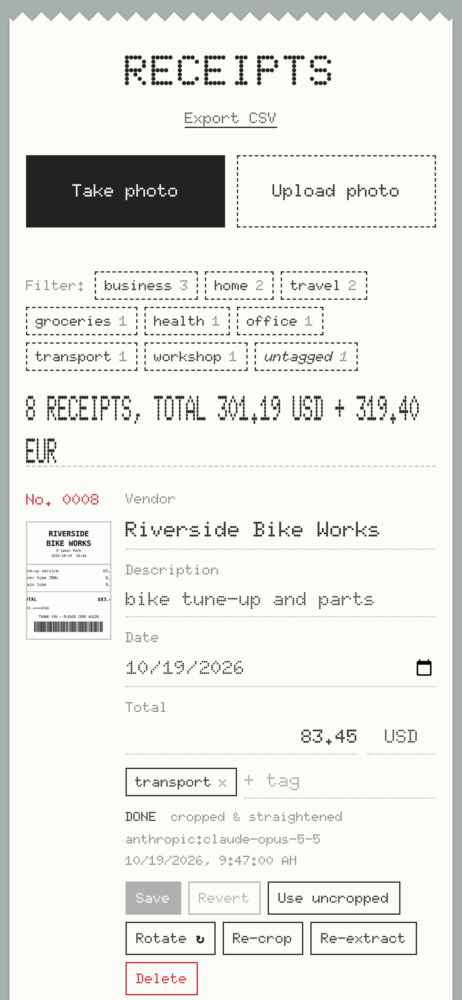
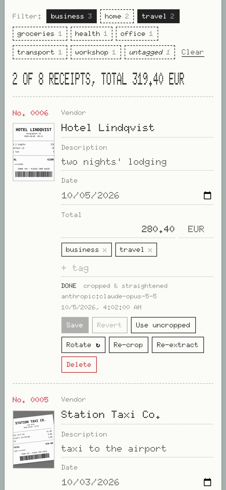
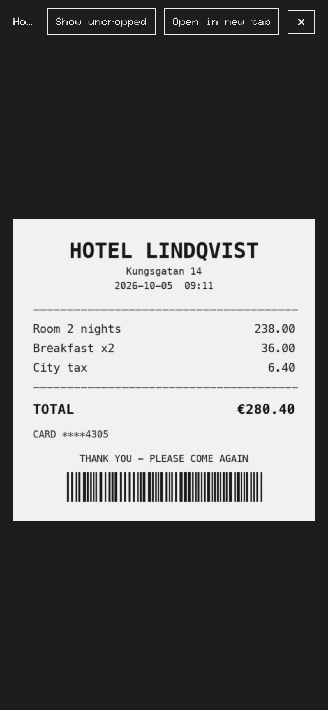
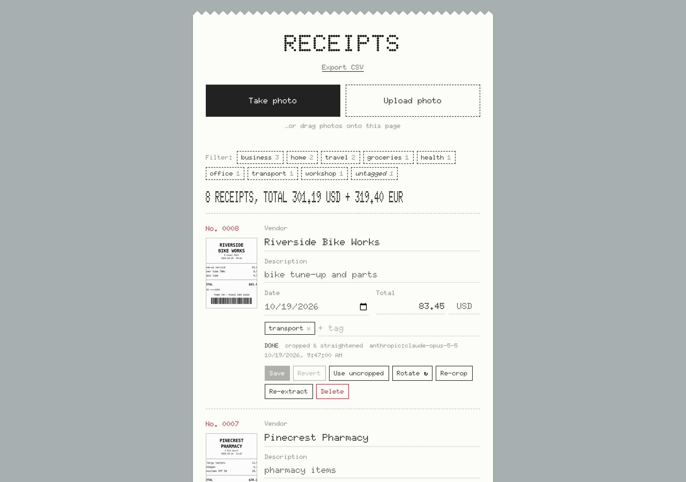

# Receipt Scanner

A small self-hosted web app for keeping receipts. Snap a photo on your phone (or upload one), and it:

- saves it as greyscale, finds the receipt in the photo, crops and straightens it, and flattens curls and
  creases with a neural unwarping model;
- has an AI model read the **vendor, total, date** and a short **description** of what was bought, and
  turns sideways photos upright;
- stores everything in SQLite, with editable fields, tags, tag filtering and CSV export.

It runs on your own computer or raspberry pi; you use it from your phone's browser on the same network.

<p align="center">
  
  
  
</p>

<p align="center"></p>

## Requirements

- [uv](https://docs.astral.sh/uv/getting-started/installation/), which installs the right Python (3.13) and
  all dependencies on first run. Plain pip works too: `pip install -e .`, then `receipt-scanner`.
- An [Anthropic API key](https://console.anthropic.com/), or a local [Ollama](https://ollama.com/) vision
  model (see [Choosing an extractor](#choosing-an-extractor)).

## Run

```sh
cp .env.example .env            # then put your ANTHROPIC_API_KEY in .env
uv run receipt-scanner          # serves on http://0.0.0.0:8000
```

Settings are read from `.env`, which git ignores. Any variable already set in your shell overrides the file.

Open `http://<your-computer's-LAN-IP>:8000` on your phone and tap **Take photo**, or **Upload photo** to pick
one or more existing photos (HEIC works too). On a computer you can also drag photos onto the page. Both use
plain file inputs, so it works over plain HTTP; no certificate is needed.

To get an app icon on your phone, use **Add to Home Screen** (Safari's share menu on iPhone, Chrome's menu
on Android). It then opens full-screen, without the browser's address bar. The icons are drawn by
`scripts/make_icons.py`; edit and rerun it (`uv run python scripts/make_icons.py`) to change them.

Each receipt can carry **tags** (e.g. "business", "home office"). Type in a receipt's tag box for suggestions
from tags you've used before, most-used first. Tags are case-insensitive, and a tag disappears once no
receipt uses it.

Tap tags in the **Filter** bar above the list to show only receipts with all the selected tags (or
"untagged" for receipts with none). The count and total above the list cover just the shown receipts, the
filter is kept in the page address so it survives a reload or bookmark, and **Export CSV** exports what's shown.

## How it works

1. **Image** (`imaging.py`): applies the EXIF rotation, converts to greyscale, and finds the receipt outline
   (brightness contour, falling back to an edge contour). It then perspective-warps the receipt flat,
   flattens curls and creases with the unwarper (see below), and boosts contrast (CLAHE). Both the
   uncropped and the corrected image are saved as JPEGs with a long edge of at most 1600px, typically
   80–200 KB each. If no receipt outline is found, only the original is kept. You can switch
   between the cropped and uncropped image for each receipt in the UI.
   This runs in a separate worker process (`worker.py`) that starts on the first photo, stays warm while
   more arrive, and exits after 5 idle minutes (`RECEIPT_WORKER_IDLE_S`), so OpenCV, numpy and the model
   are only in memory while you're scanning; the web server itself idles at well under 100 MB.
2. **Extraction** (`extractors/`): runs in the background after upload. If it fails (no key, network error),
   the photo and row are kept with `status = 'error'`, and you can press **Re-extract**.
3. **Storage**: `data/receipts.db` (table `receipts`), with images in `data/images/`. List thumbnails are
   made on demand in `data/thumbs/` and can be deleted at any time. Totals are stored as
   integer cents. Every field can be edited in the UI, and there is a CSV export at `/api/receipts.csv`.

## Choosing an extractor

| `RECEIPT_EXTRACTOR` | Settings | Notes |
|---|---|---|
| `anthropic` (default) | `ANTHROPIC_API_KEY`, `RECEIPT_ANTHROPIC_MODEL` (default `claude-opus-5-5`), `RECEIPT_ANTHROPIC_TIMEOUT` (default 90s, 1 retry) | Uses structured JSON output with low effort. Server-side refusal fallback is on. |
| `ollama` | `RECEIPT_OLLAMA_MODEL` (default `qwen2.5vl:7b`), `OLLAMA_HOST` | Fully local. Needs a vision model: `ollama pull qwen2.5vl:7b` |

To add a backend, write a class with a `name` and `extract(jpeg_bytes) -> (ReceiptFields, raw_text)`, then
register it in `extractors/__init__.py`.

## Unwarping

`RECEIPT_UNWARPER=uvdoc` (default) flattens curved or crumpled receipts with
[UVDoc](https://github.com/tanguymagne/UVDoc) (MIT), run with onnxruntime on the CPU in about 0.2 s per
receipt. On first start the server downloads the model's ONNX export (~15 MB, from the `docuwarp`
package on PyPI, verified by SHA-256) into `data/models/`. Until it's ready, or if it fails, receipts get
the plain crop. `RECEIPT_UNWARPER=none` turns it off. Backends live in `unwarp/`, and adding one works the
same way as adding an extractor.

Use **Re-crop** on a receipt to rerun detection and unwarping on its stored photo.

Other settings: `RECEIPT_DATA_DIR` (default `./data`), `HOST`, `PORT`.

## Security and privacy

- **There is no login.** Anyone who can reach the server can see, edit and delete every receipt. By default
  it listens on all network interfaces (`HOST=0.0.0.0`) so your phone can reach it over your home network.
  Only run it on a network you trust, and don't expose it to the internet (no port forwarding). Set
  `HOST=127.0.0.1` to allow only the computer it runs on.
- **Receipt photos are shared with AI** when the `anthropic` extractor is used (the default). Use `ollama` to
  keep everything on your machine.
- Your data lives in `data/` (database, photos, downloaded model) and your key in `.env`; both are ignored
  by git. Back up `data/` if you care about the receipts.
- To reach it from your phone away from home without opening it to the internet, see
  [Side quest: a Raspberry Pi you can reach from anywhere](#side-quest-a-raspberry-pi-you-can-reach-from-anywhere).

## API

| Method | Path | |
|---|---|---|
| POST | `/api/receipts` | multipart `file`; returns the new row (`status: pending`) |
| GET | `/api/receipts`, `/api/receipts/{id}` | list (optional `?tag=a&tag=b` for receipts with all those tags, or `?untagged=1`) / fetch |
| PATCH | `/api/receipts/{id}` | `vendor`, `description`, `total_cents`, `currency`, `receipt_date`, `use_scan` |
| POST | `/api/receipts/{id}/extract` | re-run extraction on the selected image |
| POST | `/api/receipts/{id}/recrop` | re-run receipt detection + unwarping on the stored original |
| POST | `/api/receipts/{id}/rotate` | rotate the stored images 90° clockwise |
| GET | `/api/tags` | every tag in use with its receipt count, most-used first |
| POST | `/api/receipts/{id}/tags` | JSON `{"name": ...}`; adds a tag (created if new) |
| DELETE | `/api/receipts/{id}/tags/{name}` | removes a tag from the receipt |
| DELETE | `/api/receipts/{id}` | deletes the row and its images |
| GET | `/api/receipts/{id}/image/{original\|scan}` | JPEG |
| GET | `/api/receipts/{id}/thumb/{original\|scan}` | small JPEG for the list |
| GET | `/api/receipts.csv` | export; takes the same `tag` / `untagged` filters |

## Raspberry Pi deployment you can reach from anywhere

You can run this app on a Pi at home and use it from your phone wherever you
are, through [Tailscale](https://tailscale.com/). Nothing is
opened to the internet, so the no-login caveat above still only covers devices you own.

<details>
<summary>Setup notes</summary>

**The Pi.** Use a Pi 3 or above; Pi 4 or 5 recommended.
Clone the repo, install uv, fill in `.env`, and check that `uv run receipt-scanner` starts.

**Keep it running** with a systemd unit, `/etc/systemd/system/receipt-scanner.service` (change `pi` and the
paths to your user and checkout):

```ini
[Unit]
Description=Receipt Scanner
After=network-online.target
Wants=network-online.target

[Service]
User=pi
WorkingDirectory=/home/pi/receipt_scanner
ExecStart=/home/pi/.local/bin/uv run receipt-scanner
Restart=on-failure

[Install]
WantedBy=multi-user.target
```

Then run `sudo systemctl enable --now receipt-scanner`, and see its logs with `journalctl -u receipt-scanner -f`.

**Tailscale.** Install it on the Pi (`curl -fsSL https://tailscale.com/install.sh | sh`, then
`sudo tailscale up`) and install the Tailscale app on your phone, signed in to the same account. With
MagicDNS (on by default), the phone can open `http://<pi-hostname>:8000` from anywhere. To get a shorter
name, rename the machine in the Tailscale admin console, e.g. to `receipts`. Do not turn on **Tailscale
Funnel** for it, since that makes it public.

### Optional: HTTPS without the port

The simplest way is `sudo tailscale serve --bg 8000`, which gives you
`https://<pi-hostname>.<your-tailnet>.ts.net` with a real certificate (turn on HTTPS certificates in the
admin console first). Then set `HOST=127.0.0.1` in `.env` so the app is only reachable through it.

### Optional: nginx reverse proxy and DNS

If you'd rather use a name like `receipts.example.com`, add a DNS
`A` record for it pointing at the Pi's Tailscale address (`tailscale ip -4`, a `100.x.y.z` address).
Anyone can look the name up, but the address only works from inside your tailnet. Put nginx in front:

```nginx
server {
    listen 80;
    server_name receipts.example.com;
    client_max_body_size 30m;   # the app's own upload limit; nginx's default of 1 MB rejects phone photos

    location / {
        proxy_pass http://127.0.0.1:8000;
        proxy_set_header Host $host;
        proxy_set_header X-Forwarded-For $proxy_add_x_forwarded_for;
        proxy_set_header X-Forwarded-Proto $scheme;
    }
}
```

and set `HOST=127.0.0.1` in `.env` here too. Plain HTTP is fine for the app, and Tailscale already encrypts
the traffic between your devices. For HTTPS on your own domain you'd need a certificate from a DNS
challenge (e.g. certbot with your DNS provider's plugin), because *Let's Encrypt* can't reach the Pi to check it.

Alternatively, you can use custom DNS entries in your home router or something like [pi hole](https://pi-hole.net/) and configure tailscale to use it remotely.

</details>

## License

[MIT](LICENSE). The UVDoc model it downloads is also MIT-licensed.
